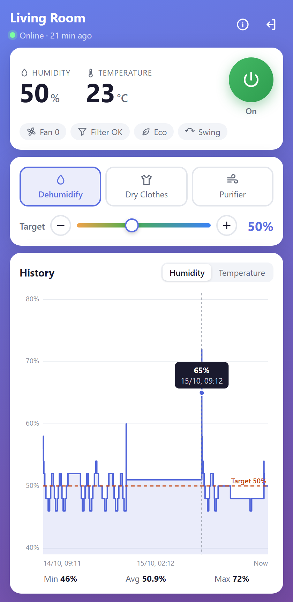
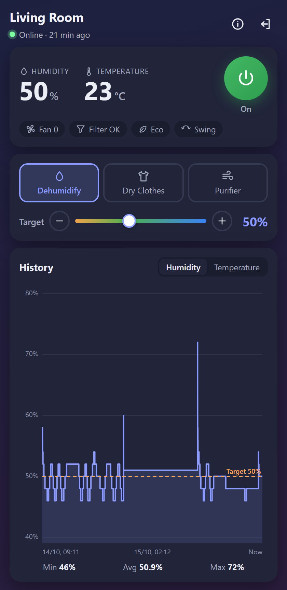
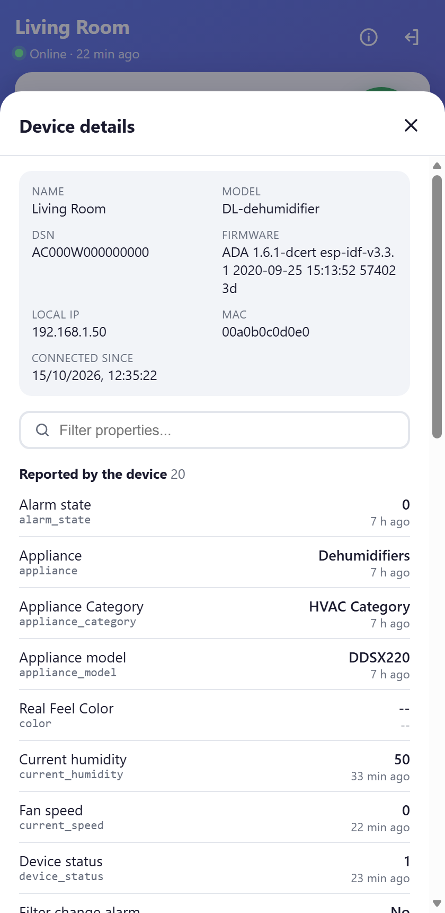
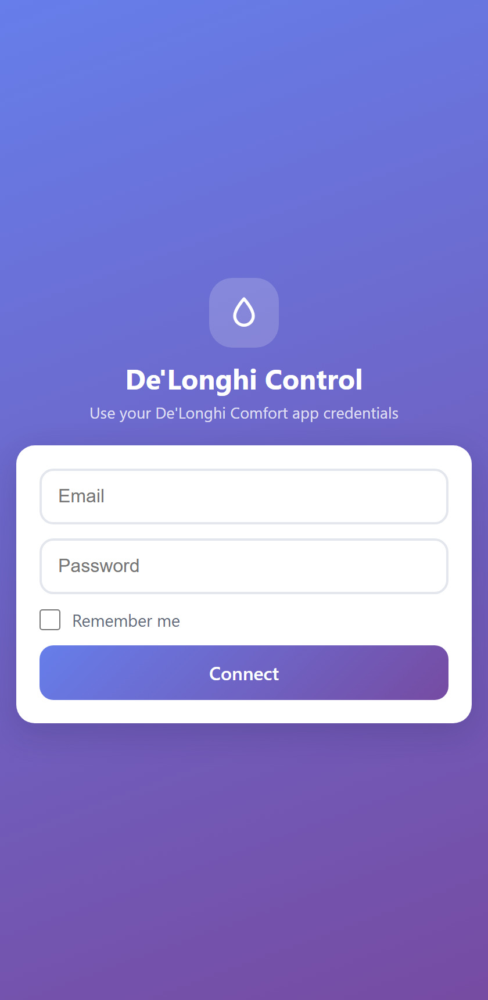

# 🌡️ De'Longhi Dehumidifier Control

Unofficial desktop app to monitor and control a **De'Longhi Tasciugo AriaDry** WiFi dehumidifier from Windows, using the same cloud API as the official De'Longhi Comfort app.

> ⚠️ This is a personal project. It is not affiliated with or endorsed by De'Longhi or Ayla Networks, and the cloud API it uses is not public, so it may stop working at any time.

<p align="center">
  
</p>

## ✨ Features

- ⏻ Turn the dehumidifier on and off
- 💧 Live humidity and room temperature, refreshed every 10 seconds
- 🎯 Target humidity from 30% to 80% (slider or −/+ buttons)
- 👕 Modes: Dehumidify, Dry Clothes, Purifier
- 🌀 Fan speed, filter, Eco and Swing status at a glance
- 🪣 Water tank and device alarm warnings
- 📈 History chart of humidity (with the target line) and temperature, with hover tooltips
- 📊 Device details view listing every property the dehumidifier reports, with search
- 🌙 Light and dark theme (follows the system setting)
- 💾 Optional "Remember me" and automatic sign-in

The main screen fits in the window without scrolling. The full property list opens in a separate details view.

## 📸 Screenshots

<table>
  <tr>
    <td align="center"><br><sub>Main screen</sub></td>
    <td align="center"><br><sub>Dark theme</sub></td>
    <td align="center"><br><sub>Device details</sub></td>
    <td align="center"><br><sub>Sign in</sub></td>
  </tr>
</table>

<sub>Screenshots use real readings. The device name, serial number (DSN), IP and MAC were replaced with placeholders.</sub>

## 📋 Requirements

1. A De'Longhi dehumidifier with WiFi (tested with the **DDSX220WFA**)
2. An account in the official **De'Longhi Comfort** app with the device already set up
3. Windows 10/11

Node.js is only needed to develop or build the app. The packaged app runs the backend with Electron's bundled runtime.

## 🚀 Usage

1. Build the app (see [Development](#-development)) or use an existing build in `electron-app/dist/win-unpacked/`
2. Run **`DeLonghi_Dehumidifier_Control.exe`**
3. Sign in with your De'Longhi Comfort credentials
4. Tick "Remember me" to sign in automatically next time

Use the ⓘ button in the top bar for device details and the exit button to sign out. Signing out also deletes the saved session.

> 💡 **Tip:** create a desktop shortcut by dragging the .exe while holding Alt.

## 🏗️ How it works

```
React UI (Vite)  ──HTTP──▶  Express backend (localhost:3001)  ──HTTPS──▶  Gigya OIDC + Ayla Networks cloud  ──▶  Dehumidifier
        ▲                                ▲
        └──────── Electron window ───────┘  (starts both servers and opens the UI)
```

- **`backend/server_v3.js`** signs in through the Gigya OIDC flow, exchanges the result for an Ayla Networks token and proxies device commands. It refreshes the token automatically and keeps the refresh token on disk, so later starts don't need the full login.
- **`frontend/`** is the React UI.
- **`electron-app/`** wraps everything into a Windows desktop app. It serves the built frontend and runs the backend in the background.

`server.js` and `server_v2.js` are earlier versions kept for reference. Use `server_v3.js`.

### Backend API

| Method | Path | Description |
|---|---|---|
| POST | `/api/login` | Sign in with De'Longhi Comfort credentials |
| POST | `/api/logout` | Forget the session and the saved refresh token |
| GET | `/api/auth/status` | Whether the backend has a valid session |
| GET | `/api/devices` | List paired devices |
| GET | `/api/devices/:dsn/status` | Summary: power, humidity, temperature, mode, fan, alarms… |
| GET | `/api/devices/:dsn/properties` | Every raw property the device reports, with timestamps |
| GET | `/api/devices/:dsn/history/:property?limit=N` | Recent values of a numeric property (max 100, an Ayla limit) |
| POST | `/api/devices/:dsn/on` · `/off` | Power on / off |
| POST | `/api/devices/:dsn/mode` | `{ "mode": 1 \| 2 \| 3 }` |
| POST | `/api/devices/:dsn/humidity` | `{ "humidity": 30-80 }` |

### Device properties (DDSX220)

The values come from Ayla properties. These are the ones the app uses:

| Property | Meaning |
|---|---|
| `set_status` | Power: `1` on, `2` off |
| `current_humidity` | Room humidity (%) |
| `room_temp` | Room temperature in tenths of °C (`230` = 23.0 °C) |
| `humidity_setpoint` | Target humidity (%) |
| `device_mode` | `1` Dehumidify, `2` Dry Clothes, `3` Purifier |
| `current_speed` | Fan speed |
| `alarm_state` | Non-zero when the device raises an alarm (e.g. water tank) |
| `filter_change_alarm` | `1` when the filter needs attention |
| `set_eco`, `swing` | Eco mode and swing flags |

Other models may use different names. The status endpoint falls back to older names (`humidity_value`, `temperature_value`, …), and the details view always shows whatever the device actually reports.

## 🔧 Development

Requires Node.js 20+.

```bash
# Install dependencies
cd backend && npm install
cd ../frontend && npm install
cd ../electron-app && npm install

# Option A: desktop app (uses the built frontend)
cd frontend && npm run build
cd ../electron-app && npm start

# Option B: browser with hot reload
cd backend && npm run dev        # http://localhost:3001
cd frontend && npm run dev       # http://localhost:5173

# Build the Windows executable
cd frontend && npm run build
cd ../electron-app && npm run build:win
```

To skip the login form during development, copy `backend/.env.example` to `backend/.env` and fill in your credentials. The backend uses them when the form is sent empty.

> **VS Code users:** terminals inside VS Code set `ELECTRON_RUN_AS_NODE`, which makes Electron start as plain Node (`Cannot read properties of undefined (reading 'isPackaged')`). Run `npm start` from a normal terminal, or unset that variable first.

## 🔒 Security

- The backend and the Electron static server listen on `127.0.0.1` only, and the API only accepts requests from the local frontend.
- Your password is never written to disk by the backend. With "Remember me", the UI stores it in `localStorage` encoded as base64, which is **not** encryption. Only use it on your own computer.
- `backend/.env` and `backend/refresh_token.txt` are git-ignored and must never be committed.

See [SECURITY.md](SECURITY.md) for details.

## 📄 License

MIT. For personal use.
